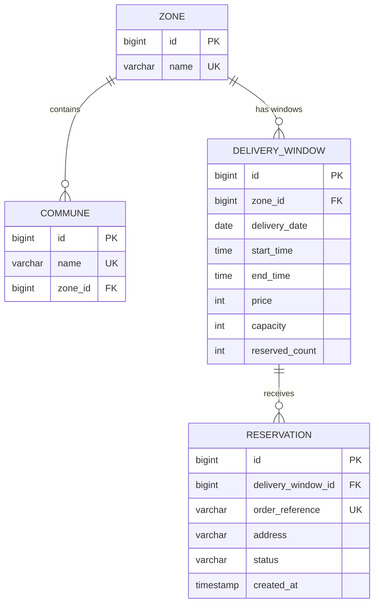

# Home Delivery – Delivery Window Booking

Booking of delivery windows with geographic coverage, capacity control and protection against overbooking.

- **Backend:** Java 21, Spring Boot 4, Spring Data JPA, H2 in-memory
- **Frontend:** React + TypeScript (Vite) + Tailwind CSS

## Requirements

| Tool | Version |
|---|---|
| JDK | 21 |
| Node.js | 22 (frontend only) |

No database or extra configuration is needed: the backend uses an in-memory H2 database seeded on startup.

## Running the project

### Backend (port 8080)

```bash
./mvnw spring-boot:run
```

- API docs (Swagger UI): http://localhost:8080/swagger-ui.html
- OpenAPI JSON: http://localhost:8080/v3/api-docs

Run the tests:

```bash
./mvnw clean test
```

> If the build fails with `class file version 65.0`, the shell is using an older JDK. Point `JAVA_HOME` to a JDK 21.

### Frontend (port 5173)

```bash
cd frontend
npm install
npm run dev
```

Open http://localhost:5173. The Vite dev server proxies `/api/*` to `http://localhost:8080`, so the backend must be running.

## Domain model



- A **commune** belongs to exactly one **zone**.
- Delivery windows (date, time range, price, capacity) are defined **per zone**, so different zones can have different schedules, prices and capacity.
- A **reservation** consumes one slot of one window. Available slots = `capacity - reserved_count`.

## API

All responses use a common envelope:

```json
{ "status": 200, "message": "…", "data": …, "error": null, "fields": null }
```

On errors `data` is `null`, `error` is the HTTP reason phrase and `fields` contains per-field messages for validation errors.

| Method | Path | Description |
|---|---|---|
| GET | `/zones` | List zones |
| GET | `/communes` | List communes with their zone |
| GET | `/available-dates?commune=` | Next 7 days with bookable windows for the commune's zone (`soldOut` when no slots remain) |
| GET | `/delivery-windows?commune=&date=yyyy-MM-dd` | Bookable windows for that commune and date, with price and remaining slots |
| POST | `/reservations` | Book a window |

`POST /reservations` body:

```json
{ "deliveryWindowId": 4, "orderReference": "any-unique-id", "address": "Monjitas 2334", "commune": "Santiago" }
```

| Status | Meaning |
|---|---|
| 201 | Reservation confirmed |
| 400 | Invalid or malformed request |
| 404 | Window or commune not found |
| 409 | Window sold out, or duplicate `orderReference` |
| 422 | Window outside the commune's zone, window past the cut-off, or date outside the allowed range |